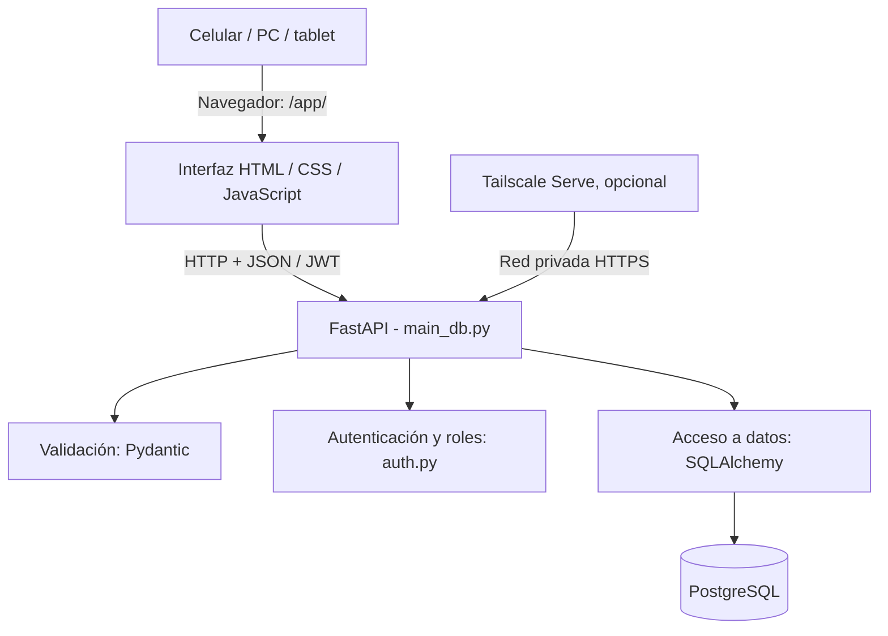

# InventarioAPI

**Estado:** prototipo en desarrollo y pruebas locales. La autenticación, consulta de productos y reporte de inventario han respondido correctamente en las pruebas realizadas. La interfaz se comunica con un servidor **FastAPI** y los datos se almacenan en **PostgreSQL**. El servidor funciona actualmente en una PC con Windows.. No se considera listo para exposición pública sin controles adicionales.

## 1. Tecnologías y arquitectura

- **API REST + JSON:** endpoints HTTP para productos, usuarios, reportes y movimientos de stock.
- **Python + FastAPI:** backend, validación de solicitudes y documentación Swagger.
- **PostgreSQL + SQLAlchemy:** almacenamiento de productos, usuarios y movimientos.
- **JWT + roles:** inicio de sesión y permisos `lector` / `admin`.
- **HTML, CSS y JavaScript:** interfaz web adaptable a PC y celular.
- **Tailscale Serve:** acceso remoto privado por HTTPS desde dispositivos autorizados.




La página y los endpoints se sirven desde la **misma aplicación FastAPI**. `frontend.py` monta los archivos estáticos bajo `/app/`; el JavaScript llama a rutas como `/auth/token`, `/productos` y `/reportes/inventario` sobre ese mismo origen. Por eso **no necesitamos configurar CORS para esta interfaz concreta**.

### ¿Por qué usamos REST?

Porque el inventario está formado por recursos identificables (productos, usuarios y movimientos) sobre los que realizamos operaciones habituales: **consultar, crear, actualizar y eliminar**. REST permite representar esas acciones mediante URLs y métodos HTTP estándar. La misma API puede consumirse desde la web del celular, una computadora o un cliente HTTP, sin duplicar la lógica del servidor.

## 2. Funcionalidades y rutas

| Método | Ruta | Operación |
|---|---|---|
| `POST` | `/auth/registro` | Registro de usuario |
| `POST` | `/auth/token` | Inicio de sesión y emisión de JWT |
| `GET` | `/auth/me` | Usuario autenticado |
| `GET` | `/productos` | Listar productos |
| `GET` | `/productos/{producto_id}` | Consultar producto |
| `POST` | `/productos` | Crear producto |
| `PUT` | `/productos/{producto_id}` | Reemplazar producto |
| `PATCH` | `/productos/{producto_id}` | Actualizar campos |
| `DELETE` | `/productos/{producto_id}` | Eliminar producto |
| `GET` | `/consultas/productos` | Búsqueda, filtros y paginación |
| `GET` | `/reportes/inventario` | Indicadores de inventario |
| `POST` | `/productos/{producto_id}/salidas` | Descontar stock y registrar movimiento |
| `GET` | `/app/` | Interfaz web |
| `GET` | `/docs` | Documentación Swagger |

**Códigos HTTP relevantes:** `200`, `201`, `204`, `400`, `401`, `403`, `404`, `405`, `409`, `422`, `500`.

> Estado del proyecto: se verificaron el inicio de sesión, las consultas y el reporte. En las últimas pruebas, `POST /productos` devolvió `405`; debe corregirse o verificarse en `/docs` antes de considerar completa la creación desde la interfaz.

## 3. Ejecutar la aplicación en Windows

Desde PowerShell, con PostgreSQL iniciado y las variables de `.env` configuradas:

**Solo en la PC:**

```powershell
cd D:\APIs\InventarioAPI
..\.venv\Scripts\python.exe -m uvicorn main_db:app --host 127.0.0.1 --port 8000
```

- Web: `http://127.0.0.1:8000/app/`
- Swagger: `http://127.0.0.1:8000/docs`

**Desde otros dispositivos de la misma red Wi-Fi:**

```powershell
cd D:\APIs\InventarioAPI
..\.venv\Scripts\python.exe -m uvicorn main_db:app --host 0.0.0.0 --port 8000
```

En otra terminal:

```powershell
ipconfig
```

Identifica la IPv4 de tu PC y abre desde el celular: `http://IP_DE_TU_PC:8000/app/` (por ejemplo, `http://192.168.18.100:8000/app/`, solo si esa sigue siendo tu IP). Ambos equipos deben estar en la misma red y el firewall debe permitir la conexión en redes privadas.

**Desde otra red, de forma privada (Tailscale):**

Inicia FastAPI con `--host 127.0.0.1` como en el primer bloque. Con Tailscale instalado y conectado en PC y celular, ejecuta en otra terminal:

```powershell
tailscale status
tailscale serve --bg 8000

tailscale serve status
```

Abre en el celular la URL HTTPS mostrada por `tailscale serve status`, agregando `/app/`. En esta modalidad, el celular debe tener acceso autorizado a la red de Tailscale. La PC y PostgreSQL deben continuar encendidos.

> En Wi-Fi local se usa HTTP sin cifrado: emplea cuentas de prueba y una red de confianza. Tailscale **Serve no hace pública** la web para visitantes anónimos.

## 4. Administración de usuarios en PostgreSQL

Ejecutar desde **pgAdmin → Query Tool** sobre la base de datos `inventario_api`:

```sql
-- Asignar permisos de administrador
UPDATE usuarios
SET rol = 'admin'
WHERE username = 'admin_local';

-- Consultar usuarios y roles
SELECT id, username, rol, activo
FROM usuarios;
```

Para devolver un usuario al rol de consulta:

```sql
UPDATE usuarios
SET rol = 'lector'
WHERE username = 'admin_local';
```

Roles: `lector` consulta información; `admin` puede realizar operaciones de administración según los permisos configurados en la API. La asignación directa por SQL se utiliza únicamente para la administración controlada de este prototipo.

### . Seguridad: estado y pendientes

**Lo implementado en el laboratorio:** hashes de contraseñas con Argon2, JWT firmado con expiración, consulta del usuario en PostgreSQL, validación de cuentas activas, y roles `lector`/`admin`.

**Antes de abrirlo al público:**

1. Restringir el registro de usuarios (`POST /auth/registro`); no dejar altas ilimitadas por internet.
2. Aplicar límites de intentos y tasa a login y rutas sensibles.
3. Usar HTTPS para credenciales y tokens; nunca reutilizar contraseñas personales de ejemplo.
4. Administrar secretos con variables de entorno seguras y rotación de claves.
5. Añadir registros de auditoría, copias de seguridad, pruebas automáticas y manejo centralizado de errores.
6. Implementar migraciones de base de datos; revisar borrado de productos con movimientos históricos.
7. Considerar sesiones/revocación de tokens y un proveedor de identidad con Authorization Code + PKCE para una aplicación más grande.

La integración actual de OAuth2 Password Form **no equivale a implementar todas las funciones de un servidor OAuth2/OpenID Connect**.


## 5. Estructura del proyecto

```text
InventarioAPI/
├── main.py             # Primera versión de aprendizaje (en memoria)
├── main_db.py          # Endpoints REST conectados a PostgreSQL
├── database.py         # Engine y sesiones SQLAlchemy
├── models.py           # Modelos/tables ORM: Producto, MovimientoStock, Usuario
├── schemas.py          # Esquemas de entrada y salida Pydantic
├── auth.py             # Hash de contraseñas, JWT y roles
├── frontend.py         # Monta la interfaz en /app/
├── web/
│   ├── index.html      # Estructura de la página
│   ├── styles.css      # Diseño adaptable
│   └── app.js          # Llamadas HTTP a FastAPI
├── .env                # Configuración local PRIVADA (no publicar)
└── .gitignore          # Exclusiones para Git
```

**Seguridad:** no publicar `.env`, contraseñas ni claves JWT. Antes de abrir el servidor al público se deben reforzar el registro de usuarios, las restricciones de acceso y la protección del inicio de sesión.
